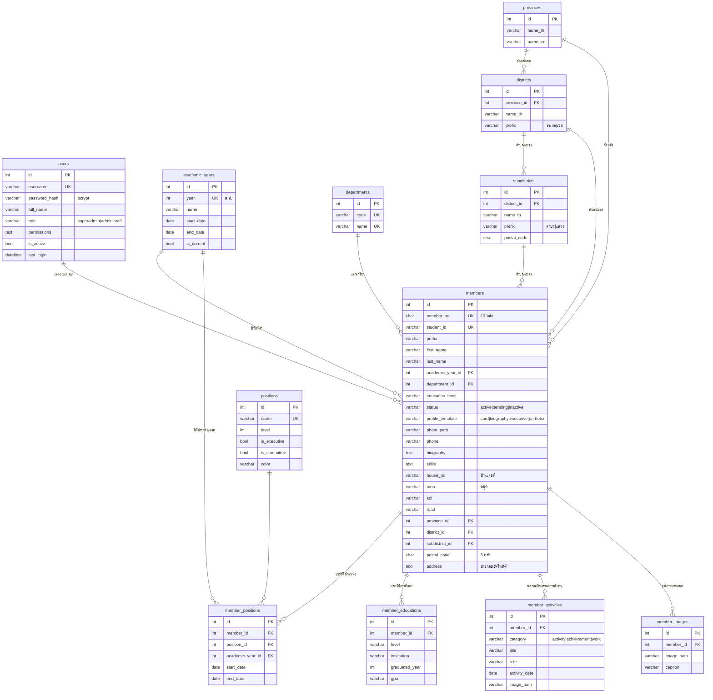

# ER Diagram — ระบบบริหารจัดการสมาชิกองค์การนักวิชาชีพแห่งประเทศไทย วิทยาลัยเทคนิคมีนบุรี

## หลักการออกแบบ

| ประเด็น | การออกแบบ |
|---|---|
| เลขสมาชิก 10 หลัก ห้ามซ้ำ | `UNIQUE` + `CHECK(length=10, ตัวเลขล้วน)` ในฐานข้อมูล, ตรวจซ้ำใน Python และ JavaScript |
| ประวัติตำแหน่งหลายปี | ตาราง `member_positions` แยก, `UNIQUE(member_id, academic_year_id)` = ปีละ 1 ตำแหน่ง |
| ตำแหน่งปัจจุบันของสมาชิก | ระเบียน `member_positions` ของปีการศึกษาล่าสุด (ถ้าไม่มี = สมาชิกทั่วไป) |
| ลบสมาชิก | `ON DELETE CASCADE` ลบประวัติตำแหน่ง/การศึกษา/ผลงาน/รูปภาพตามไปด้วย |
| ลบปีการศึกษา / ตำแหน่งที่ถูกใช้งาน | `ON DELETE RESTRICT` ป้องกันข้อมูลกำพร้า |
| รูปภาพ | เก็บไฟล์ใน `backend/uploads/` และเก็บเฉพาะ path ในฐานข้อมูล (เข้าถึงได้เมื่อมี token เท่านั้น) |
| ย้ายฐานข้อมูล | ใช้ SQLAlchemy ทั้งหมด เปลี่ยนแค่ `DATABASE_URL` ใน `config.py` |
